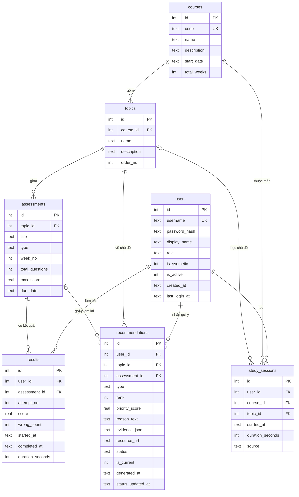

# Thiết kế cơ sở dữ liệu – StudyLens

> Công việc W1-B1 (cập nhật sau W1-B3) · Phiên bản 1.2 · Trạng thái: **Bản nháp, chờ Thành viên 1 review ở cuối tuần 1**
> DDL tham chiếu: [`schema.sql`](./schema.sql). Nguồn chính thức là model SQLAlchemy (`backend/app/models/`) và migration Alembic; test tự động đối chiếu hai bên với nhau.

## 1. Tổng quan

7 bảng, phục vụ FR01–FR08, FR12 và để sẵn chỗ cho FR09, FR11:



Chuỗi quan hệ chính: `courses → topics → assessments → results ← users`. Gợi ý và phiên học là hai nhánh phụ gắn vào `users` và `topics`.

## 2. Từ điển dữ liệu

Cột nào ghi "app" nghĩa là ràng buộc đó **không thể đặt trong SQLite**, backend (Pydantic) phải kiểm tra khi nhận dữ liệu.

### 2.1 `users`

| Cột | Kiểu | Ràng buộc | Ghi chú |
|---|---|---|---|
| id | INTEGER | PK | |
| username | TEXT | NOT NULL, UNIQUE, không phân biệt hoa thường | Dùng để đăng nhập (FR01). |
| password_hash | TEXT | NOT NULL | Băm bcrypt. Không bao giờ lưu hay trả về mật khẩu thô. |
| display_name | TEXT | NOT NULL | Có thể là biệt danh (NFR07). |
| role | TEXT | `student` hoặc `admin`, mặc định `student` | MVP chỉ dùng `student`. |
| is_synthetic | INTEGER | 0/1, mặc định 1 | 1 = dữ liệu mô phỏng, đáp ứng yêu cầu "ghi rõ là dữ liệu thử nghiệm". |
| is_active | INTEGER | 0/1 | Khóa tài khoản mà không xóa dữ liệu. |
| created_at, last_login_at | TEXT | ISO 8601 UTC | |

Cố ý **không lưu email, họ tên thật, mã số sinh viên** để hạn chế dữ liệu cá nhân (NFR07).

### 2.2 `courses`

| Cột | Kiểu | Ràng buộc | Ghi chú |
|---|---|---|---|
| id | INTEGER | PK | |
| code | TEXT | UNIQUE | Ví dụ `DEMO101`. |
| name, description | TEXT | name NOT NULL | |
| start_date | TEXT | NOT NULL, `YYYY-MM-DD` | Ngày đầu tuần 1, dùng để đổi ngày thực tế sang số tuần. |
| total_weeks | INTEGER | > 0 | |

### 2.3 `topics`

| Cột | Kiểu | Ràng buộc | Ghi chú |
|---|---|---|---|
| id | INTEGER | PK | |
| course_id | INTEGER | FK → courses, CASCADE | |
| name | TEXT | NOT NULL, duy nhất trong môn | |
| description | TEXT | | |
| order_no | INTEGER | ≥ 1, duy nhất trong môn | Thứ tự hiển thị nhất quán giữa các trang (NFR04). |

### 2.4 `assessments`

Bài tập, quiz hoặc bài kiểm tra. **Mỗi bài thuộc đúng một chủ đề.** Tổng số bài của môn là mẫu số tính "tiến độ hoàn thành".

| Cột | Kiểu | Ràng buộc | Ghi chú |
|---|---|---|---|
| id | INTEGER | PK | |
| topic_id | INTEGER | FK → topics, CASCADE | Môn học suy ra qua `topics.course_id`, không lặp lại ở đây. |
| title | TEXT | NOT NULL, duy nhất trong chủ đề | |
| type | TEXT | `exercise`, `quiz`, `exam` | |
| week_no | INTEGER | ≥ 1 | Bài thuộc tuần học thứ mấy. **Dùng để gom nhóm theo tuần (FR07).** App: `week_no ≤ courses.total_weeks`. |
| total_questions | INTEGER | > 0 | |
| max_score | REAL | > 0, mặc định 10 | Cho phép các bài có thang điểm khác nhau. |
| due_date | TEXT | `YYYY-MM-DD`, có thể trống | |

### 2.5 `results`

Mỗi dòng là **một lần làm bài**. Làm lại bài sẽ tạo dòng mới với `attempt_no` tăng lên, lịch sử không bị ghi đè (FR03).

| Cột | Kiểu | Ràng buộc | Ghi chú |
|---|---|---|---|
| id | INTEGER | PK | |
| user_id | INTEGER | FK → users, CASCADE | |
| assessment_id | INTEGER | FK → assessments, CASCADE | |
| attempt_no | INTEGER | ≥ 1, mặc định 1 | `(user_id, assessment_id, attempt_no)` duy nhất. |
| score | REAL | ≥ 0 | Điểm thô. App: `score ≤ assessments.max_score`. |
| wrong_count | INTEGER | ≥ 0 | Số câu trả lời sai (đầu vào của FR04, FR05). App: `wrong_count ≤ assessments.total_questions`. |
| started_at | TEXT | trống được, `≤ completed_at` | |
| completed_at | TEXT | NOT NULL | Thời điểm hoàn thành. |
| duration_seconds | INTEGER | ≥ 0, trống được | Thời gian làm bài. |

### 2.6 `study_sessions` (FR09 – giao diện làm sau MVP)

| Cột | Kiểu | Ràng buộc | Ghi chú |
|---|---|---|---|
| id | INTEGER | PK | |
| user_id | INTEGER | FK → users, CASCADE | |
| course_id | INTEGER | FK → courses, CASCADE | |
| topic_id | INTEGER | FK → topics, **trống được**, SET NULL | Trống nghĩa là học chung, không theo chủ đề cụ thể. App: nếu có, chủ đề phải thuộc `course_id`. |
| started_at | TEXT | NOT NULL | |
| duration_seconds | INTEGER | 1 đến 86 400 | Chặn phiên học dài bất thường. |
| source | TEXT | `seed`, `manual`, `timer` | Phân biệt dữ liệu mô phỏng với dữ liệu người dùng nhập. |

### 2.7 `recommendations` (FR05, FR06, FR11)

| Cột | Kiểu | Ràng buộc | Ghi chú |
|---|---|---|---|
| id | INTEGER | PK | |
| user_id | INTEGER | FK → users, CASCADE | |
| topic_id | INTEGER | FK → topics, CASCADE | |
| assessment_id | INTEGER | FK, trống được, SET NULL | Trống nghĩa là gợi ý cả chủ đề. |
| type | TEXT | `review_topic`, `retry_assessment`, `practice_more` | Khớp FR05: chủ đề, bài tập hoặc nội dung cần ôn. |
| rank | INTEGER | ≥ 1 | 1 là ưu tiên cao nhất. |
| priority_score | REAL | ≥ 0 | Điểm ưu tiên do rule tính ra. |
| reason_text | TEXT | NOT NULL | Câu giải thích hiển thị cho sinh viên (FR06). |
| evidence_json | TEXT | JSON hợp lệ, có **ít nhất 1 lý do** | Số liệu làm căn cứ để kiểm chứng (NFR05). Xem mẫu bên dưới. |
| resource_url | TEXT | trống được | Liên kết tài liệu ôn tập. |
| status | TEXT | `pending`, `accepted`, `dismissed`, `completed`; mặc định `pending` | MVP chỉ ghi `pending`. FR11 sau này chỉ cần thêm nút. |
| is_current | INTEGER | 0/1, mặc định 1 | Xem mục 4.3. |
| generated_at, status_updated_at | TEXT | | |

Mẫu `evidence_json` (khuôn dạng chính thức nằm ở `metrics-definition.md` mục 5.5, trùng với `reasons` và `metrics` trong API):

```json
{
  "reasons": [
    {"code": "low_average", "detail": "Điểm trung bình của chủ đề là 25%, thuộc mức yếu (dưới 50%)."}
  ],
  "metrics": {
    "avg_pct": 25.0, "done": 2, "wrong_total": 15, "total_questions": 20, "wrong_rate_pct": 75.0,
    "trend": {"status": "down", "delta_pct": -10.0, "latest_pct": 20.0, "previous_pct": 30.0}
  }
}
```

Ba mã lý do: `low_average`, `many_wrong_answers`, `declining_trend` (điều kiện kích hoạt: `metrics-definition.md` mục 5.1).

## 3. Bảng ánh xạ yêu cầu → dữ liệu

| Yêu cầu | Dữ liệu sử dụng |
|---|---|
| FR01, FR12 | `users` (username, password_hash, is_active). Phiên đăng nhập dùng JWT nên không có bảng session. |
| FR02 Dashboard | Điểm TB, số câu sai từ `results` + `assessments`; tiến độ = số bài đã làm / tổng số bài của môn; thời gian học từ `study_sessions`. |
| FR03 Theo chủ đề | `results` → `assessments` → `topics`; lịch sử là các `attempt_no`. |
| FR04 Mạnh/yếu | Điểm TB % và `wrong_count` gom theo chủ đề. |
| FR05, FR06 Gợi ý | Ghi vào `recommendations` (`reason_text` + `evidence_json`). |
| FR07 Theo tuần | Gom theo `assessments.week_no`. |
| FR08 Cập nhật | `INSERT` vào `results` rồi tính lại chỉ số và gợi ý (mục 4.3). |
| FR09 (hoãn) | `study_sessions` đã có đủ. |
| FR10 (hoãn) | Lọc theo `topic_id` và khoảng `completed_at` đã được chỉ mục hỗ trợ. |
| FR11 (hoãn) | `recommendations.status` đã có. |
| NFR07 | `users.is_synthetic`, không lưu thông tin định danh. |

## 4. Quyết định thiết kế cần Thành viên 1 và 2 cùng biết

### 4.1 Điểm lưu thô, phần trăm tính khi truy vấn
`score` và `max_score` được lưu riêng, `score × 100 / max_score` chỉ tính khi cần. Nhờ vậy không có hai nguồn sự thật có thể lệch nhau, thuận lợi cho kiểm thử độ chính xác (NFR03).

### 4.2 Làm lại bài: dùng lần làm nào để tính điểm?
Schema lưu **mọi lần làm**. Quy tắc tính (lần gần nhất, lần cao nhất hay trung bình) là **quyết định nghiệp vụ**, cần chốt trong `metrics-definition.md` (W1-B6). Các truy vấn mẫu dưới đây tạm dùng **lần làm gần nhất** của mỗi bài.

### 4.3 Tính lại gợi ý
Khi có dữ liệu mới (FR08), backend:
1. Đặt `is_current = 0` cho toàn bộ gợi ý hiện hành của sinh viên đó.
2. Chèn các gợi ý mới với `is_current = 1`.

Làm cả hai bước trong **một transaction**. Chỉ mục `uq_recs_current` đảm bảo không có hai gợi ý hiện hành trùng nhau. Lịch sử gợi ý cũ vẫn còn để đánh giá sau này.

### 4.4 "Tuần" trong FR07 là tuần của bài, không phải tuần nộp
Biểu đồ theo tuần gom theo `assessments.week_no`. Cách này ổn định, dễ tạo dữ liệu mô phỏng và dễ kiểm tra. Nếu muốn gom theo thời điểm làm thật, dùng `courses.start_date` và `completed_at` để tính; schema hỗ trợ cả hai.

### 4.5 MVP chưa có bảng đăng ký môn học
Tiến độ lấy mẫu số là **toàn bộ bài của môn**, nghĩa là mọi sinh viên trong MVP học chung một môn. Nếu sau này cần nhiều môn và mỗi sinh viên học một số môn, thêm bảng `enrollments(user_id, course_id)` mà không phải sửa 7 bảng hiện có.

### 4.6 Những điều SQLite không làm được
| Vấn đề | Cách xử lý |
|---|---|
| Khóa ngoại mặc định **tắt** | Bật `PRAGMA foreign_keys = ON` ở **mỗi kết nối** (SQLAlchemy: gắn vào sự kiện `connect`). Quên bước này thì `ON DELETE CASCADE` và kiểm tra khóa ngoại không chạy. |
| Không có kiểu DATETIME/BOOLEAN thật | Lưu thời gian dạng chuỗi ISO 8601 UTC, boolean dạng 0/1. |
| Không đặt được CHECK giữa hai bảng | `score ≤ max_score`, `wrong_count ≤ total_questions`, `week_no ≤ total_weeks` do Pydantic kiểm tra (đã đánh dấu "App" ở mục 2). |
| Đổi cấu trúc cột khó | Dùng Alembic với `render_as_batch=True` ngay từ đầu. |

## 5. Truy vấn mẫu (đã chạy thử với dữ liệu giả, kết quả khớp tính tay)

Dùng chung đoạn lấy "lần làm gần nhất":

```sql
WITH latest AS (
  SELECT r.* FROM results r
  WHERE r.attempt_no = (SELECT MAX(attempt_no) FROM results
                        WHERE user_id = r.user_id AND assessment_id = r.assessment_id)
)
```

**Điểm TB %, số câu sai, số bài đã làm theo chủ đề (FR03, FR04):**

```sql
SELECT t.id, t.name,
       ROUND(AVG(l.score * 100.0 / a.max_score), 1) AS avg_pct,
       SUM(l.wrong_count) AS wrong_total,
       COUNT(*)           AS done
FROM latest l
JOIN assessments a ON a.id = l.assessment_id
JOIN topics t      ON t.id = a.topic_id
WHERE l.user_id = :uid
GROUP BY t.id
ORDER BY avg_pct;
```

**Điểm TB % theo tuần (FR07):**

```sql
SELECT a.week_no, ROUND(AVG(l.score * 100.0 / a.max_score), 1) AS avg_pct, COUNT(*) AS done
FROM latest l JOIN assessments a ON a.id = l.assessment_id
WHERE l.user_id = :uid
GROUP BY a.week_no ORDER BY a.week_no;
```

**Tiến độ hoàn thành (FR02):**

```sql
SELECT COUNT(DISTINCT r.assessment_id) AS done,
       (SELECT COUNT(*) FROM assessments a JOIN topics t ON t.id = a.topic_id
        WHERE t.course_id = :cid)       AS total
FROM results r
JOIN assessments a ON a.id = r.assessment_id
JOIN topics t      ON t.id = a.topic_id
WHERE r.user_id = :uid AND t.course_id = :cid;
```

> Ghi chú: truy vấn tiến độ ở file này đủ cho schema. Khi viết `metrics.py`, nên tính trong Pandas và đối chiếu lại với các truy vấn này để kiểm thử NFR03.

## 6. Model SQLAlchemy và migration (W1-B3, đã làm)

- Mỗi bảng một file trong `backend/app/models/`; migration khởi tạo trong `backend/alembic/versions/`.
- `schema.sql` giờ chỉ là bản **tham chiếu để đọc**. Test `test_migration_matches_reference_schema` và
  `test_migration_and_reference_reject_the_same_bad_data` so sánh nó với DB do Alembic tạo ra
  (cột, khóa ngoại, chỉ mục, và hành vi khi nhận dữ liệu sai). Sửa một bên mà quên bên kia thì test báo lỗi.
- Chỉ mục `uq_recs_current` dùng biểu thức nên Alembic autogenerate không thấy; nó được viết tay trong migration.
- Mọi ràng buộc đều có tên (quy ước trong `app/core/database.py`) để Alembic sửa được bảng SQLite sau này.

## 7. Checklist W1-B1

- [x] 7 bảng, khóa chính, khóa ngoại, quy tắc xóa liên quan
- [x] Ràng buộc CHECK, UNIQUE và chỉ mục cho các truy vấn chính
- [x] DDL chạy được trên SQLite 3.45, kèm kiểm thử dữ liệu hợp lệ và không hợp lệ
- [x] Ánh xạ yêu cầu FR/NFR → dữ liệu
- [x] Sơ đồ ER (Mermaid)
- [x] Model SQLAlchemy và migration Alembic (W1-B3), có test đối chiếu với `schema.sql`
- [ ] Thành viên 1 review (kiểm tra schema có đủ dữ liệu cho 5 màn hình wireframe không)
- [ ] Xuất sơ đồ ER thành `er-diagram.png` (dán đoạn Mermaid ở mục 1 vào mermaid.live rồi tải ảnh)
- [ ] Chốt quy tắc "lần làm nào được tính" ở `metrics-definition.md` (W1-B6)

## 8. Lịch sử thay đổi

| Phiên bản | Thay đổi | Lý do |
|---|---|---|
| 1.0 | Bản đầu tiên (W1-B1) | |
| 1.1 | Sửa CHECK của `recommendations.evidence_json` | Bản 1.0 để lọt `{}` và `{"metrics": {...}}` (không có khóa `reasons`), vì `NULL >= 1` trong SQL cho kết quả NULL chứ không phải sai, và CHECK chỉ từ chối khi kết quả là sai. Biểu thức mới dùng `CASE` + `COALESCE`, từ chối mọi trường hợp không có ít nhất một lý do. |
| 1.2 | Đổi khuôn mẫu `evidence_json` (mục 2.7) | Thống nhất với `metrics-definition.md` và `openapi.yaml`; bản cũ chỉ có `trend_delta` và `low_average`/`declining_trend`. Không đổi schema CSDL. |
| 1.1 | Bỏ chỉ mục `idx_topics_course` | Thừa: `UNIQUE (course_id, name)` đã tạo chỉ mục có `course_id` đứng đầu. |
